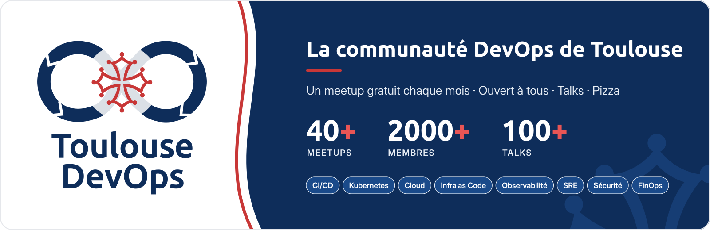

  

  
  
  
  
  

Toulouse DevOps rassemble les passionnés d'infrastructure, d'automatisation et de culture DevOps dans la Ville Rose. Nous organisons des **meetups gratuits** avec des talks techniques, des retours d'expérience et du networking.

Que tu sois dev, ops, SRE ou simplement curieux, **tu es le bienvenu !**

## Les sujets qu'on aborde

Kubernetes, CI/CD, Observabilité, Platform Engineering, Infrastructure as Code, SRE, Docker, Terraform, Ansible, DevSecOps, Cloud, FinOps, Service Mesh...

## Proposer un talk

Tu veux partager un retour d'expérience ou présenter un outil ? Contacte-nous via [Meetup](https://www.meetup.com/fr-FR/Toulouse-DevOps/) ou nos réseaux sociaux.

## Charte graphique

Logo, couleurs et kakemono sont disponibles sur [toulouse-devops.org/brand](https://toulouse-devops.org/brand/), sous licence CC BY 4.0.
